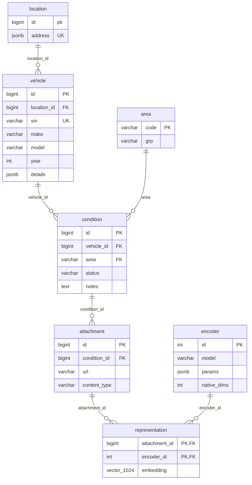
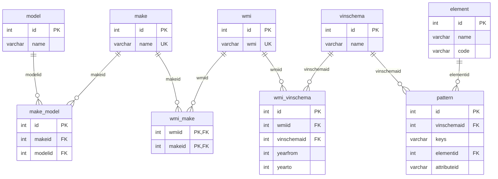

Several competitors already exist. Car-Part.com and Hollander both advertice yard inventory, network marketplaces, and full interchange derived from VIN, though neither seem to be advertising AI features. [Photomate](https://products.car-part.com/photomate/details.html), from Car-Part.com, allows managing all of this through a phone app & photos. [Tractable](tractable.ai) claims to do all this through vision AI, with deep integration across salvage yards, body shops, and insurance companies. Pricing for these is not easily publicly accessible; based on their markets, they're almost certainly large annual contract agreements.

With this in mind, we are going to focus our app on a hobbiest to hobbiest market segment. Rather than exhaustive vehicle and part catalogs, we're going to make it easy for anyone to list and search vehicles. We're going to design our database around two core flows - upload a vehicle with damage, and find a vehicle with _complementary_ damage. Our app will trust the hobbiests to understand what parts they may want to find from a vehicle, and instead provide them a way to find a vehicle that has an undamaged area that part is in. For instance, if I got rear ended while driving a 2015 Toyota Camry, I would be OK with a bumper from any color Camry from 2012 through 2018 that has front quarter damage. Similarly, if someone needed a hood bracket, they might be interested in one from my vehicle.

For baseline data, we will begin with [NHTSA vPIC](https://vpic.nhtsa.dot.gov/api/) for VIN/Make/Model information. This provides both API access, but better, it provides a data export alread in Postgress format. This will anchor our data model. It begins with Make/Model information, along with a VIN decoder schema & patterns. The `wmi` relations connect VINs with their manufacturer defined formats, allowing for VIN based lookup & verification. See apendix for details.

From this base, we will layer on our vehicle specific data. For each vehicle, we capture its VIN, duplicate its make/model/year (denormalized for quicker lookup and indexing, as once it's been validated against the VIN, it is immutable data). We then add a `condition` table, which lets us add an arbitrary number of `condition` relations on a vehicle.

`vehicle` relation with `vin`, denormalized `make`, `model`, `year`, `trim`, `color`, and `json` `details`. A `vehicle` can have any number of `condition` relations associated, which describe an `area` of the car & its condition, optionally with attached photos. The standard `area`s are the 8 exterior views, the 4 wheel views, mirrors, the top, undercarriage, interior, and engine block views. Each condition can have zero or more `attachment`s, stored as links to http/s endpoints, typically `s3` or equivalent blob storage. A `representation` relation allows recording vector data for an `attachment`; the specific encoder for the `representation` lives in an `encoder` relation that describes which model & parameters were used to create the representation, so that representations can be filtered before similarity search.

<tabs>
<tab title="SQL>

```sql
CREATE EXTENSION IF NOT EXISTS vector;
CREATE SCHEMA yard;

CREATE TABLE yard.location (
  id      bigserial PRIMARY KEY,
  address jsonb,
)

CREATE TABLE yard.vehicle (
  id          bigserial PRIMARY KEY,
  location_id bigint NOT NULL REFERENCES yard.location(id),
  vin         varchar(17) NOT NULL UNIQUE,
  make    varchar,
  model   varchar,
  year    int,
  trim    varchar,
  color   varchar,
  details jsonb NOT NULL DEFAULT '{}'
);

-- Standard areas: 8 exterior, 4 wheel, top, bottom, interior, engine.
CREATE TABLE yard.area (
  code varchar PRIMARY KEY,
  grp  varchar NOT NULL
);

INSERT INTO yard.area (code, grp) VALUES
  ('front', 'exterior'), ('front_left', 'exterior'), ('left', 'exterior'), ('rear_left', 'exterior'),
  ('rear', 'exterior'), ('rear_right', 'exterior'), ('right', 'exterior'), ('front_right', 'exterior'),
  ('wheel_front_left', 'wheel'), ('wheel_front_right', 'wheel'),
  ('wheel_rear_left', 'wheel'), ('wheel_rear_right', 'wheel'),
  ('top', 'body'), ('bottom', 'body'), ('interior', 'body'), ('engine', 'body');

CREATE TABLE yard.condition (
  id         bigserial PRIMARY KEY,
  vehicle_id bigint NOT NULL REFERENCES yard.vehicle(id) ON DELETE CASCADE,
  area       varchar NOT NULL REFERENCES yard.area(code),
  status     varchar NOT NULL DEFAULT 'unknown' CHECK (status IN ('usable', 'damaged', 'unknown')),
  notes      text
);

CREATE TABLE yard.attachment (
  id           bigserial PRIMARY KEY,
  condition_id bigint NOT NULL REFERENCES yard.condition(id) ON DELETE CASCADE,
  url          varchar NOT NULL CHECK (url ~ '^https?://'),  -- typically s3 or equivalent blob storage
  content_type varchar
);

CREATE TABLE yard.encoder (
  id            serial PRIMARY KEY,
  model         varchar NOT NULL,              -- e.g. dinov2-base
  params        jsonb NOT NULL DEFAULT '{}',   -- preprocessing, crop, pooling, etc.
  native_dims   int NOT NULL CHECK (native_dims BETWEEN 1 AND 1024),  -- size before zero extension
  UNIQUE (model, params)
);

CREATE TABLE yard.representation (
  attachment_id bigint REFERENCES yard.attachment(id) ON DELETE CASCADE,
  encoder_id    int REFERENCES yard.encoder(id),
  embedding     vector(1024) NOT NULL,         -- zero extended from encoder.native_dims
  PRIMARY KEY (attachment_id, encoder_id)
);

CREATE INDEX ON yard.vehicle (make, model, year);
CREATE INDEX ON yard.condition (vehicle_id);
CREATE INDEX ON yard.condition (area, status);
CREATE INDEX ON yard.attachment (condition_id);
CREATE INDEX ON yard.representation (encoder_id);

-- Per-encoder ANN index so a similarity query only scans one encoder's vectors, e.g. encoder 1:
-- CREATE INDEX ON yard.representation USING hnsw (embedding vector_cosine_ops) WHERE encoder_id = 1;
```

</tab>
<tab title="Diagram">


</tab>
</tabs>


This database supports the following flows:

- New car intake: Record Vin, verify Make/Model/etc, walk through taking photos of the primary areas, and progressively fill in data & encodings.

- Car Finder: Given a vehicle that's completed intake (at least with conditions, not necessarily photos), find vehicles which have overlapping make/model/year (stretch goal: expand to compatible families), and complementary status areas (for areas that the search vehicles are marked `damaged` or `unknown`, the search vehicles areas should be `usable`), sorted by simple lat/lon distance (Assume a geocoded `lat` and `lon` in `location.address`).

```sql
-- :vehicle_id is the vehicle we're searching
WITH src AS (
  SELECT v.id, v.make, v.model, v.year,
         (l.address ->> 'lat')::float8 AS lat,
         (l.address ->> 'lon')::float8 AS lon
  FROM yard.vehicle v
  JOIN yard.location l ON l.id = v.location_id
  WHERE v.id = :vehicle_id
),
needed AS (            -- areas the search vehicle cannot supply itself
  SELECT DISTINCT c.area
  FROM yard.condition c
  JOIN src ON src.id = c.vehicle_id
  WHERE c.status IN ('damaged', 'unknown')
)
SELECT v.id, v.vin, v.make, v.model, v.year, v.trim, v.color, v.location_id,
        -- Haversine great-circle distance
       2 * 6371 * asin(least(1, sqrt(
         power(sin(radians((l.address ->> 'lat')::float8 - src.lat) / 2), 2) +
         cos(radians(src.lat)) * cos(radians((l.address ->> 'lat')::float8)) *
         power(sin(radians((l.address ->> 'lon')::float8 - src.lon) / 2), 2)
       ))) AS distance_km
FROM yard.vehicle v
JOIN yard.location l ON l.id = v.location_id
JOIN src
  ON  v.make  = src.make
  AND v.model = src.model
  AND v.year  = src.year      -- stretch: replace with a join through a compatible family table
  AND v.id   <> src.id
WHERE NOT EXISTS (            -- all needed areas must not be `damaged` on the found vehicle
  SELECT 1
  FROM needed n
  WHERE NOT EXISTS (
    SELECT 1
    FROM yard.condition c
    WHERE c.vehicle_id = v.id
      AND c.area = n.area
      AND c.status IN ('usable', 'unknown')
  )
)
ORDER BY distance_km NULLS LAST, v.id;
```


## Appendix: vPIC

<tabs>
<tab title="SQL">

```sql
CREATE SCHEMA vpic;

CREATE TABLE vpic.make (
  id   int PRIMARY KEY,
  name varchar UNIQUE
);

CREATE TABLE vpic.model (
  id   int PRIMARY KEY,
  name varchar
);

CREATE TABLE vpic.make_model (
  id      int PRIMARY KEY,
  makeid  int REFERENCES vpic.make(id),
  modelid int REFERENCES vpic.model(id)
);

CREATE TABLE vpic.wmi (
  id  int PRIMARY KEY,
  wmi varchar UNIQUE  -- first 3 VIN characters
);

CREATE TABLE vpic.wmi_make (
  wmiid  int REFERENCES vpic.wmi(id),
  makeid int REFERENCES vpic.make(id),
  PRIMARY KEY (wmiid, makeid)
);

CREATE TABLE vpic.vinschema (
  id   int PRIMARY KEY,
  name varchar
);

CREATE TABLE vpic.wmi_vinschema (
  id          int PRIMARY KEY,
  wmiid       int REFERENCES vpic.wmi(id),
  vinschemaid int REFERENCES vpic.vinschema(id),
  yearfrom    int,
  yearto      int,
  UNIQUE (vinschemaid, wmiid, yearfrom)
);

CREATE TABLE vpic.element (
  id   int PRIMARY KEY,
  name varchar,
  code varchar
);

CREATE TABLE vpic.pattern (
  id          int PRIMARY KEY,
  vinschemaid int REFERENCES vpic.vinschema(id),
  keys        varchar,
  elementid   int REFERENCES vpic.element(id),
  attributeid varchar,  -- lookup id or literal value; not FK-enforced
  UNIQUE (vinschemaid, keys, elementid)
);

CREATE INDEX ON vpic.make_model (makeid, modelid);
CREATE INDEX ON vpic.make_model (modelid) INCLUDE (makeid);
CREATE INDEX ON vpic.wmi_make (makeid);
CREATE INDEX ON vpic.wmi_vinschema (wmiid);
CREATE INDEX ON vpic.pattern (vinschemaid);
CREATE INDEX ON vpic.pattern (elementid) INCLUDE (attributeid);
```

</tab>

<tab title="diagram">


</tab>
</tabs>
